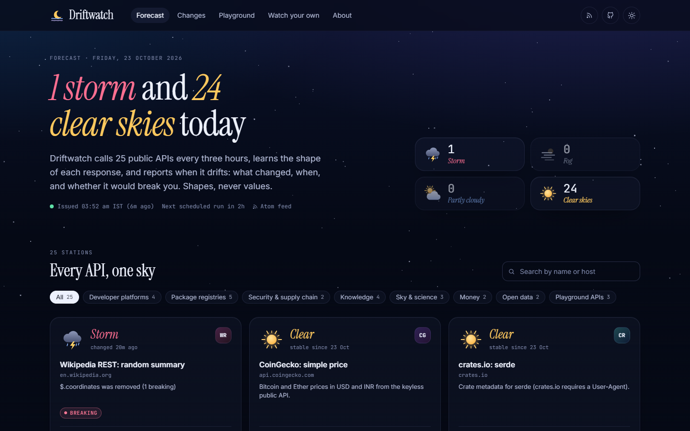
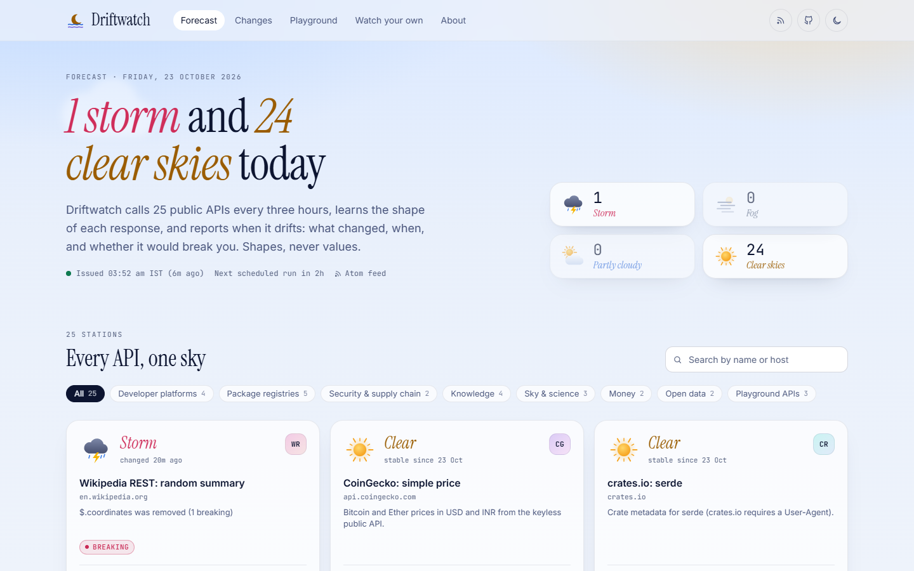
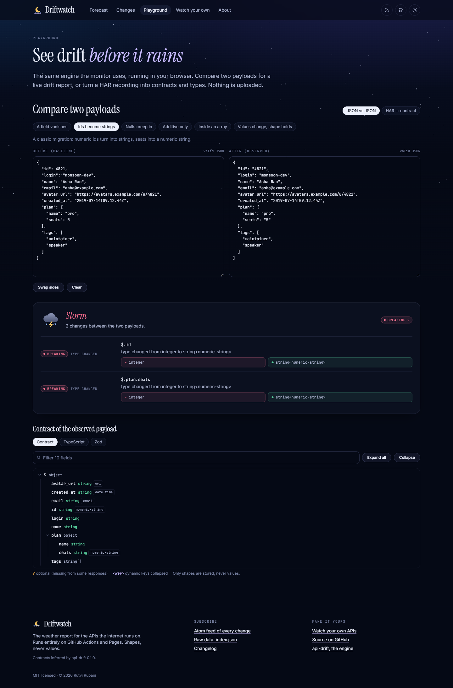
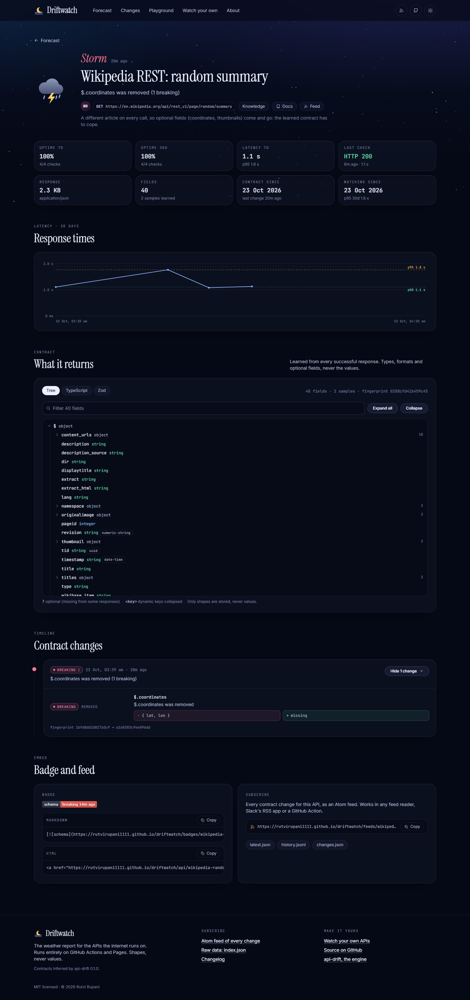

# Driftwatch

**The weather report for the APIs the internet runs on.**

Third-party APIs change shape without telling anyone: a field disappears, an id becomes a string,
`null` starts showing up. Driftwatch watches 25 public JSON APIs from the outside, learns the shape of
every response with [api-drift](https://github.com/rutvirupani1111/api-drift), and publishes a forecast:
what changed, when, and whether it would break you.

Zero infrastructure. GitHub Actions does the checking, the repository is the database (git-scraping),
GitHub Pages hosts the dashboard. Fork it to watch your own APIs for free, with secrets in GitHub
Secrets and alerts in Slack or Discord.

**Live:** https://rutvirupani1111.github.io/driftwatch/ · **Feed:** [`/feed.xml`](https://rutvirupani1111.github.io/driftwatch/feed.xml)



<table>
  <tr>
    <td width="50%"></td>
    <td width="50%"></td>
  </tr>
  <tr>
    <td></td>
    <td></td>
  </tr>
</table>

## What you get

- **A forecast per API.** Clear skies (stable for 7 days), partly cloudy (additive or risky changes),
  storm (a breaking change this week), fog (the latest check failed). Uptime and p50 / p95 latency over
  7 and 30 days, a 30-day climate heatmap, and a headline like *"1 storm and 24 clear skies today"*.
- **Contracts, not snapshots.** Every response is merged into a learned contract (required vs optional
  fields, formats, nullability). Drift is reported only when that contract moves, once, with
  api-drift's severities: breaking, risky, info.
- **The whole story per API**: a collapsible contract tree, generated TypeScript and Zod, a change
  timeline with before → after for every path, a latency chart, and embeddable badges
  (`schema: stable` / `changed 2d ago` / `breaking 1h ago`).
- **Subscribe anywhere**: a global Atom feed, one feed per API, optional Discord / Slack webhooks for
  breaking and risky changes, and the GitHub run summary.
- **A Playground**: paste two JSON payloads for a live drift report, or drop a browser HAR recording to
  get contracts, TypeScript and Zod for every endpoint. Runs in your browser; nothing is uploaded.
- **Watch your own**: a step-by-step template guide and a form that writes `driftwatch.config.json`.
- **Privacy by construction**: only shapes are stored, never values. Secrets are substituted in memory
  and a test walks every written file to prove they never land on disk.

## The 25 stations

Every endpoint is public, needs no key, and was verified by hand on 2026-10-23. Each gets one request
per run (8 a day) with a User-Agent that links back here.

| Category | API | Request |
| --- | --- | --- |
| Developer platforms | [GitHub REST: repository](https://docs.github.com/en/rest/repos/repos#get-a-repository) | `GET api.github.com` |
| Developer platforms | [GitLab: project](https://docs.gitlab.com/api/projects/#get-a-single-project) | `GET gitlab.com` |
| Developer platforms | [Stack Exchange: site info](https://api.stackexchange.com/docs/info) | `GET api.stackexchange.com` |
| Developer platforms | [Docker Hub: repository](https://docs.docker.com/reference/api/hub/latest/) | `GET hub.docker.com` |
| Package registries | [npm registry: react@latest](https://github.com/npm/registry/blob/main/docs/REGISTRY-API.md) | `GET registry.npmjs.org` |
| Package registries | [PyPI JSON: requests](https://docs.pypi.org/api/json/) | `GET pypi.org` |
| Package registries | [crates.io: serde](https://crates.io/data-access) | `GET crates.io` |
| Package registries | [Homebrew formula: wget](https://formulae.brew.sh/docs/api/) | `GET formulae.brew.sh` |
| Package registries | [jsDelivr: package stats](https://www.jsdelivr.com/docs/data.jsdelivr.com) | `GET data.jsdelivr.com` |
| Security & supply chain | [deps.dev: package version](https://docs.deps.dev/api/v3/) | `GET api.deps.dev` |
| Security & supply chain | [OSV: vulnerability query](https://google.github.io/osv.dev/post-v1-query/) | `POST api.osv.dev` |
| Knowledge | [Wikipedia REST: random summary](https://en.wikipedia.org/api/rest_v1/) | `GET en.wikipedia.org` |
| Knowledge | [Open Library: work](https://openlibrary.org/dev/docs/api/books) | `GET openlibrary.org` |
| Knowledge | [Hacker News: item](https://github.com/HackerNews/API) | `GET hacker-news.firebaseio.com` |
| Knowledge | [Hugging Face Hub: model](https://huggingface.co/docs/hub/api) | `GET huggingface.co` |
| Sky & science | [Open-Meteo: forecast](https://open-meteo.com/en/docs) | `GET api.open-meteo.com` |
| Sky & science | [Sunrise-Sunset: Mumbai](https://sunrise-sunset.org/api) | `GET api.sunrise-sunset.org` |
| Sky & science | [Where the ISS at: position](https://wheretheiss.at/w/developer) | `GET api.wheretheiss.at` |
| Money | [Frankfurter: FX rates](https://frankfurter.dev/) | `GET api.frankfurter.dev` |
| Money | [CoinGecko: simple price](https://docs.coingecko.com/reference/simple-price) | `GET api.coingecko.com` |
| Open data | [Nager.Date: next holidays](https://date.nager.at/Api) | `GET date.nager.at` |
| Open data | [Open Food Facts: product](https://openfoodfacts.github.io/openfoodfacts-server/api/) | `GET world.openfoodfacts.org` |
| Playground APIs | [PokeAPI: pokemon](https://pokeapi.co/docs/v2) | `GET pokeapi.co` |
| Playground APIs | [JSONPlaceholder: post](https://jsonplaceholder.typicode.com/guide/) | `GET jsonplaceholder.typicode.com` |
| Playground APIs | [Dog CEO: random image](https://dog.ceo/dog-api/documentation/) | `GET dog.ceo` |

Real drift showed up while this was being built: REST Countries retired its keyless v3.1 API (it now
answers `{"success": false, …}` with HTTP 200 and needs a key, so it is not on the list), and the
Wikipedia random-summary station recorded `$.coordinates` disappearing within an hour of watching.

## How it works

```
cron 17 */3 * * *  ─►  call each API once  ─►  infer the shape (api-drift, values dropped)
       ─►  merge into the learned contract  ─►  fingerprint moved?  ─►  diff → change event
       ─►  history · weather · feeds · badges · webhooks  ─►  commit if something changed  ─►  Pages
```

Read [docs/ARCHITECTURE.md](docs/ARCHITECTURE.md) for the learning model, data formats, commit policy
and design system.

## Run it locally

Requires Node 20+. api-drift is imported from source from the sibling folder `../api-drift`
(see [DEPLOY.md](DEPLOY.md) for how CI gets it).

```bash
npm install
npm run monitor          # check every API now, update data/, feeds and badges
npm run dev              # the dashboard on http://localhost:5185/driftwatch/
```

| Script | What it does |
| --- | --- |
| `npm run monitor` | One monitor pass. Flags: `--only id,id`, `--rebaseline id\|all`, `--restore dir`, `--no-alerts`. |
| `npm run typecheck` | TypeScript for the site, the monitor/tests and the Playwright specs. |
| `npm test` | 67 Vitest tests, fully offline (fake fetch). |
| `npm run build` | Production build for GitHub Pages (`BASE_PATH`, default `/driftwatch/`). |
| `npm run e2e` | Playwright smoke test of the built site on port 5185. |
| `npm run screenshots` | Regenerates the images in `docs/screenshots/`. |

On Windows the Playwright scripts drive the installed Microsoft Edge; elsewhere run
`npx playwright install chromium` once (or set `PW_CHANNEL`).

## Watch your own APIs

1. **Use this template** (or fork), then edit `driftwatch.config.json`:

   ```json
   {
     "id": "payments-charge",
     "name": "Payments: charge",
     "category": "Vendors",
     "url": "https://api.vendor.example/v1/charges/ch_test_123",
     "headers": { "Authorization": "Bearer ${VENDOR_API_KEY}" },
     "docs": "https://docs.vendor.example/charges",
     "ignore": ["$.metadata"]
   }
   ```

2. Add `VENDOR_API_KEY` as a repository secret and pass it to the monitor step in
   `.github/workflows/monitor.yml`.
3. Settings → Pages → Source: **GitHub Actions**; enable Actions; run **Monitor**.

[template.md](template.md) covers everything (clearing the sample data, alerts, schedule, privacy).
The dashboard's *Watch your own* page builds the config for you.

## Workflows

- **Monitor** (`.github/workflows/monitor.yml`): every 3 hours at :17, on demand and on push. Restores
  state from the Actions cache, runs the monitor, commits data **only when a fingerprint or status
  changed** (plus a weekly heartbeat), builds the site with the right base path and deploys it with
  `actions/deploy-pages`.
- **CI** (`.github/workflows/ci.yml`): typecheck, tests and a production build on every pull request,
  then a Playwright smoke test of that build.

## Project layout

```
driftwatch.config.json   the monitors          monitor/   the Node pipeline (tsx)
data/                    observations (git)     src/lib/   shared: api-drift adapter, weather, types
public/feed.xml, feeds/, badges/  generated     src/       the React site
tests/  Vitest           e2e/  Playwright       docs/      ARCHITECTURE, STATUS, screenshots
```

## Credits

Built by Rutvi Rupani. Contract engine: [api-drift](https://github.com/rutvirupani1111/api-drift).
Typefaces: Instrument Serif, Inter and JetBrains Mono (via Fontsource). Thank you to every team running
the public APIs above.

[MIT](LICENSE) © 2026 Rutvi Rupani
